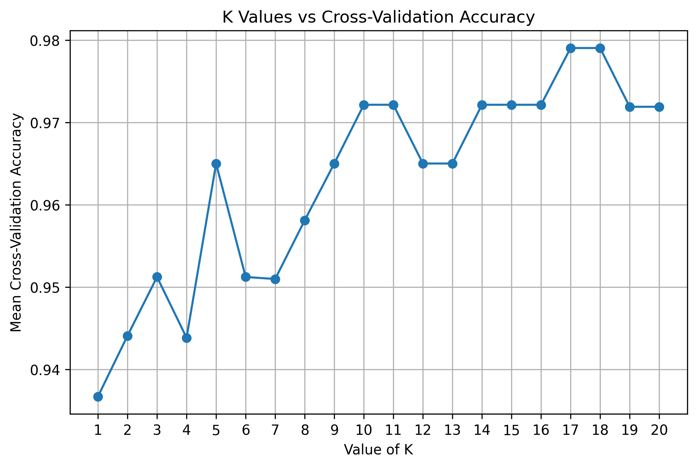
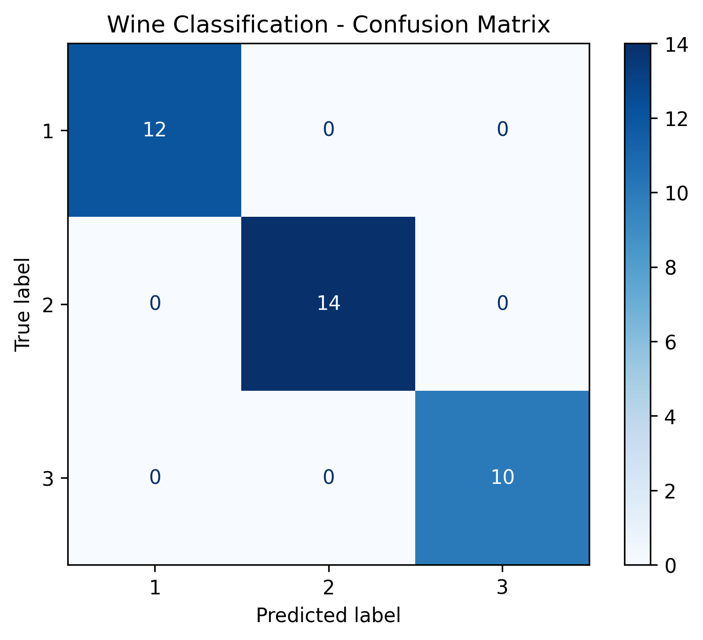

# Wine Classification using K-Nearest Neighbors (KNN)

## 📌 Project Overview

This project implements a Machine Learning classification model using the **K-Nearest Neighbors (KNN)** algorithm to classify wine samples based on their input features.

The project uses a Scikit-learn Pipeline to combine feature scaling and model training. It also evaluates multiple values of K using cross-validation to select the best-performing value.

## 🎯 Objectives

- Load and clean the wine dataset.
- Separate input features and the target variable.
- Split the dataset into training and testing sets.
- Build a Machine Learning Pipeline using `StandardScaler` and `KNeighborsClassifier`.
- Evaluate different K values using cross-validation.
- Select the best K value based on mean cross-validation accuracy.
- Evaluate the final model using accuracy, confusion matrix, and classification report.
- Generate and save evaluation graphs.

## 🛠️ Technologies Used

- Python
- Pandas
- Matplotlib
- Scikit-learn
- K-Nearest Neighbors (KNN)
- StandardScaler
- Machine Learning Pipeline
- Cross-Validation

## 📂 Project Structure

```text
Wine_Prediction/
│
├── WinePredictorKNN.py
├── WinePredictor.csv
├── README.md
├── requirements.txt
├── K_vs_Accuracy.png
└── Confusion_Matrix.png
```

*Note: The two PNG images are generated automatically when the program runs successfully.*

## ⚙️ Machine Learning Workflow

1. **Load Dataset:** Read the CSV file using Pandas.
2. **Data Cleaning:** Remove rows containing missing values.
3. **Feature Selection:** Separate independent variables (`X`) and target variable (`Class`).
4. **Train-Test Split:** Split the dataset into 80% training data and 20% testing data.
5. **Pipeline Creation:** Combine `StandardScaler` and `KNeighborsClassifier`.
6. **Hyperparameter Tuning:** Evaluate K values from 1 to 20, subject to training dataset size, using 5-fold cross-validation.
7. **Visualization:** Plot K values against mean cross-validation accuracy.
8. **Best K Selection:** Select the K value with the highest mean cross-validation accuracy.
9. **Final Model Training:** Train the selected Pipeline on the complete training split.
10. **Model Evaluation:** Calculate test accuracy.
11. **Confusion Matrix:** Display and save the confusion matrix.
12. **Classification Report:** Display precision, recall, and F1-score.

## 📊 Visualizations

### K Values vs Cross-Validation Accuracy

This graph compares different K values to help identify the best-performing KNN configuration.



### Confusion Matrix

The confusion matrix compares actual and predicted classes to show the classification results.



## 🚀 Installation and Execution

### 1. Clone the Repository

```bash
git clone https://github.com/vaishnaviphapale29/Wine-Prediction.git
```

### 2. Navigate to the Project Folder

```bash
cd Wine-Prediction
```

### 3. Install Dependencies

```bash
pip install -r requirements.txt
```

### 4. Run the Project

```bash
python WinePredictorKNN.py
```

Ensure that `WinePredictor.csv` is present in the same folder as the Python script.

## 📈 Evaluation Metrics

The model reports the following metrics:

- **Accuracy:** Overall proportion of correct predictions.
- **Confusion Matrix:** Comparison of actual and predicted classes.
- **Precision:** Correct positive predictions relative to all positive predictions.
- **Recall:** Correctly identified positive samples relative to all actual positive samples.
- **F1-Score:** Harmonic mean of precision and recall.

Actual performance metrics depend on the dataset and the selected K value.

## 💡 Key Features

- Modular Python function for model execution.
- Feature scaling integrated into a Pipeline.
- Cross-validation-based K selection.
- Reproducible train-test split.
- Automatic graph generation and saving.
- Evaluation using multiple classification metrics.
- Project-relative paths for dataset and visualization files.

## 🔮 Future Improvements

- Add a dedicated validation strategy for hyperparameter selection.
- Compare KNN with Decision Tree, Logistic Regression, and Random Forest.
- Add automated model saving and loading.
- Introduce additional evaluation metrics and automated testing.